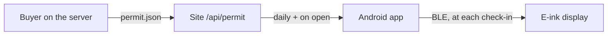

# Toronto Parking Permit Display


Battery-powered ESP32 e-ink display that shows your Toronto temporary parking permit. Gets new permits over Bluetooth from the [parking-permit-android](https://github.com/VisTechProjectsOrg/parking-permit-android) app and switches to the next permit on its own at midnight. No cable needed.

## Hardware

- [Heltec Vision Master E290](https://heltec.org/project/vision-master-e290/) (ESP32-S3 + 2.9" e-ink)
- 1S LiPo on the JST 1.25mm battery plug: protected cell, 1000mAh+ rated 1A+ (the board charges at ~1A)
- Button on GPIO 21, LED on GPIO 45, battery sense on GPIO 7

## How It Works



1. [parking-permit-buyer](https://github.com/VisTechProjectsOrg/parking-permit-buyer) buys the next permit on the server.
2. The app fetches it from the site and keeps advertising over Bluetooth.
3. The display deep-sleeps (~20µA) and wakes to check in with the phone: 8 AM and 7 PM, and every 30 minutes during the day once the current permit ends within 24 hours.
4. It stores the current and next permit, gets the time from the phone, and switches to the next permit when it starts.
5. It reports its battery level back, which the app shows.

## Usage

| Action | Result |
|--------|--------|
| **Short press** | Sync with the phone now |
| **Long press (3s)** | Sync and redraw even if nothing changed |
| **Low battery** | Battery icon on the display, notification in the app |

## Setup

### 1. Upload Firmware

```bash
pio run -e vision_e290 --target upload
```

On a sleeping board: hold BOOT, tap RST, release BOOT, then upload. For development, `pio run -e dev --target upload` builds a version that never sleeps.

### 2. Install Android App

Install [parking-permit-android](https://github.com/VisTechProjectsOrg/parking-permit-android) and allow Bluetooth, battery and "keep running" access when it asks.

### 3. Sync

Press the display's button with the phone nearby. After that it checks in on its own.

## BLE Protocol

The phone runs the GATT server (service `0000ff00-...`); the display connects as a client:
- `ff01` read: permit JSON with the cached next permit and the phone's local time
- `ff02` write: sync type (auto, button, long press)
- `ff03` write: status `shownPermit,cachedPermit,batteryMv,fwVersion`

## Files

- `src/main.cpp` - Wake, sync, draw, sleep
- `src/permit_store.h` - Current + next permit, which one to show
- `src/power_helper.h` - Battery read, LoRa sleep, deep sleep
- `src/bluetooth_helper.h` - BLE sync with the phone
- `src/permit_config.h` - Display layout constants
- `src/Code39Generator.h` - Barcode rendering

## Branches

- `main` / `dev` - Battery BLE version (current)
- `wifi-only` - Original WiFi version
- `permit` - Old permit data branch, no longer used

## Related Projects

- [parking-permit-buyer](https://github.com/VisTechProjectsOrg/parking-permit-buyer) - Buys permits and serves them from the site
- [parking-permit-android](https://github.com/VisTechProjectsOrg/parking-permit-android) - Android companion app
- [Parking permit website](https://fucktorontoparking.ca/) - Web dashboard

## Notes

- E-ink keeps the image with no power, so a dead battery still shows the last permit
- Display can be flipped 180° in the app's display settings
